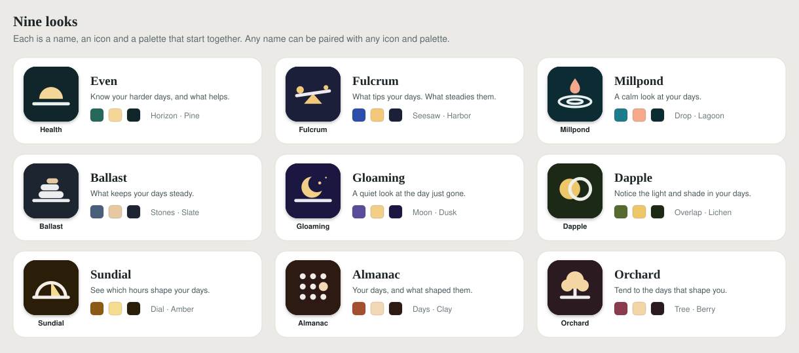
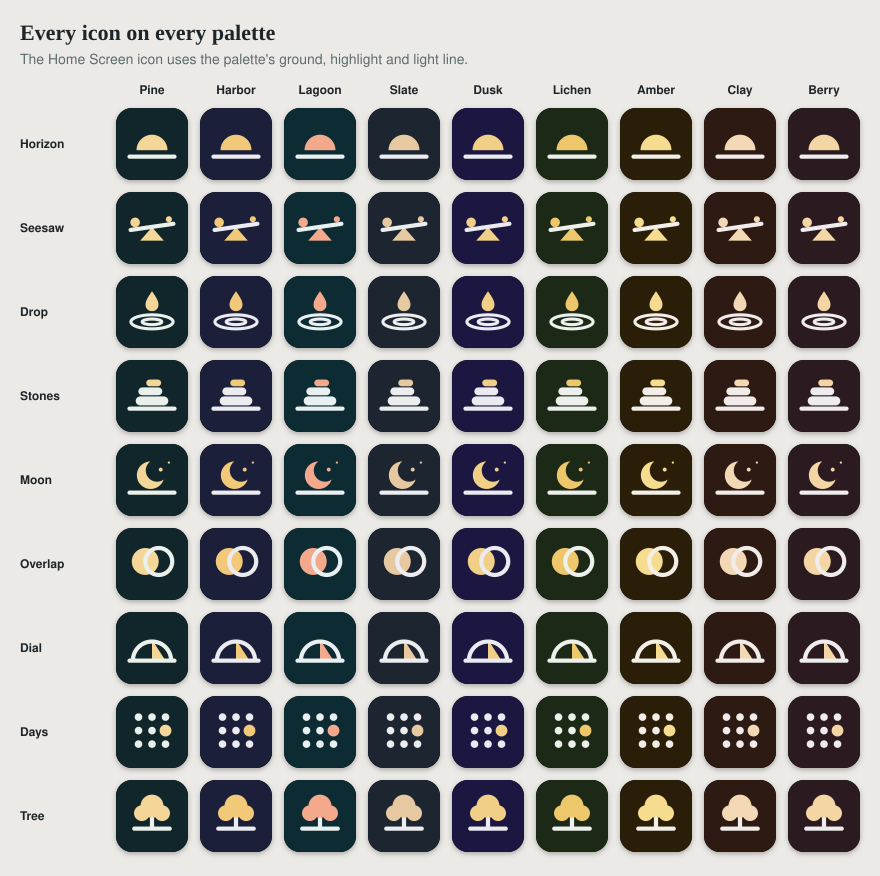

# Look catalogue

Nine names, nine icons and nine palettes to choose a rebrand from, drawn to be mixed: any name with any icon and any palette. Each name starts with the icon and palette drawn for it. The look the app had when this was drawn (Even, Horizon and Pine) is the first of each, so a person can always go back.

## Names

Each name sets the app's name, its Home Screen label (12 characters at most), its tagline and the pitch that follows "Try Name, " (`names.json`).

| | Name | Home Screen label | Tagline | Starts with |
| --- | --- | --- | --- | --- |
| n1 | Even | Health | Know your harder days, and what helps. | Horizon, Pine |
| n2 | Fulcrum | Fulcrum | What tips your days. What steadies them. | Seesaw, Harbor |
| n3 | Millpond | Millpond | A calm look at your days. | Drop, Lagoon |
| n4 | Ballast | Ballast | What keeps your days steady. | Stones, Slate |
| n5 | Gloaming | Gloaming | A quiet look at the day just gone. | Moon, Dusk |
| n6 | Dapple | Dapple | Notice the light and shade in your days. | Overlap, Lichen |
| n7 | Sundial | Sundial | See which hours shape your days. | Dial, Amber |
| n8 | Almanac | Almanac | Your days, and what shaped them. | Days, Clay |
| n9 | Orchard | Orchard | Tend to the days that shape you. | Tree, Berry |

Even keeps its label, Health.

**Checking the names.** For each name, a web search alongside "mood", "journal" and "health app" found no app in this space using it. They are ordinary words, so other products share some of them. This is not a trademark or App Store search: run both before settling on one.

## Palettes

Three main colors each (`palettes.json`). The build works out the other fifty or so roles from them, in light and dark, and stops if any text would be hard to read.

| | Name | Primary | Highlight | Ground | Tightest text pair |
| --- | --- | --- | --- | --- | --- |
| p1 | Pine | `#28685B` | `#F4D798` | `#10262A` | 4.9:1 |
| p2 | Harbor | `#2B4FA8` | `#F2C879` | `#1B1F3A` | 6.0:1 |
| p3 | Lagoon | `#1F7A8C` | `#F4A98D` | `#0C2B33` | 4.7:1 |
| p4 | Slate | `#4A5F7A` | `#E7C9A1` | `#1D2530` | 5.7:1 |
| p5 | Dusk | `#5B4B9A` | `#F2CF86` | `#1C1741` | 6.3:1 |
| p6 | Lichen | `#566B2E` | `#EFC76B` | `#1C2917` | 4.8:1 |
| p7 | Amber | `#8C5A14` | `#F5DC8F` | `#2A1E08` | 5.2:1 |
| p8 | Clay | `#A4502F` | `#F3D8B6` | `#2D1A12` | 5.6:1 |
| p9 | Berry | `#8A3B4E` | `#F3D6A4` | `#2B1A20` | 5.8:1 |

The tightest pair is the lowest contrast among the pairs the build checks (text on page and on cards, muted text, links on cards, and button text), in both appearances. The build requires 4.5:1. Every icon's accent and line stand out from their tile by at least 7.7:1.

## Icons

Square, 512 by 512, drawn from plain shapes in the three palette colors (`icons.json`, `icons/`).

| | Name | Shows |
| --- | --- | --- |
| i1 | Horizon | A sun resting on the horizon |
| i2 | Seesaw | A beam tipping on its point, the heavier weight lower |
| i3 | Drop | A drop above still water and its ripples |
| i4 | Stones | Three stones stacked in balance, the top one warm |
| i5 | Moon | A crescent moon holding a star, over the horizon |
| i6 | Overlap | A disc of light and a ring of shade, overlapping |
| i7 | Dial | A sundial's pointer inside its dial |
| i8 | Days | A grid of days, with one that stands out |
| i9 | Tree | A tree over its ground |

### What an icon must do

These are the logo rules in `BRANDING.md`, plus what pulling to refresh needs. `tests/catalog.test.cjs` checks all of it.

- The first shape is the rounded background, filled `{{color.contrast.light}}`. It is dropped where the icon sits on its own, in the header and the sign-in sheet.
- Colors are only `{{color.highlight.light}}`, `{{color.on-contrast.light}}` and the background. The header and sign-in sheet recolor two things so that they follow the palette in both appearances: fills in the highlight and strokes in `on-contrast`. So the highlight is for filled shapes, one warm accent, and everything light is a **stroke**, even a dot (a stroke with no length and round ends).
- The root names where the horizon is (`data-horizon`) and how far below it the rising parts start (`data-rise`). Parts marked `data-pull="rise"` come up into place from behind the horizon. Parts marked `data-pull="line"` are strokes that draw themselves. Every icon except Horizon has at least one of each.
- No scripts, text, images, `<use>`, styles or `id`s, so several can sit in one page.

The pull to refresh animates only Horizon, from `brand/pull-mark.svg`. Any other icon shows still while pulling, which `BRANDING.md` allows. The marks above are what lets the build draw the animation for every icon from the icon itself.

## Files

| File | What it holds |
| --- | --- |
| `names.json` | The nine names with label, tagline, pitch and starting icon and palette |
| `palettes.json` | The nine sets of three main colors |
| `icons.json`, `icons/` | The nine icons. `i1` is the logo the app had when this was drawn, and a test fails if the logo in use isn't one of the nine |
| `overview.svg`, `icons-on-palettes.svg` | The two sheets above. `node scripts/catalog-sheets.cjs` draws them again, and a test fails when they're out of date |

## Trying and choosing

**Trying a combination.** Add it to `brand/looks.json` with the name, the palette's three colors as `colors`, and the icon's path as `logo` (for example `brand/catalog/icons/i5-gloaming.svg`). Then run `node scripts/preview-looks.cjs previews "Name"`, or the **Preview looks** workflow. Nothing reaches the live app.

**Choosing one.** Say which of each, for example "Gloaming, with the Stones icon and the Harbor palette". Then follow "Starting from the catalogue" in `BRANDING.md`: the name's fields go into `brand/brand.json`, the palette's colors into `colors`, and the icon over `brand/logo.svg`. The icon on a phone's Home Screen only changes when the app is added again.
